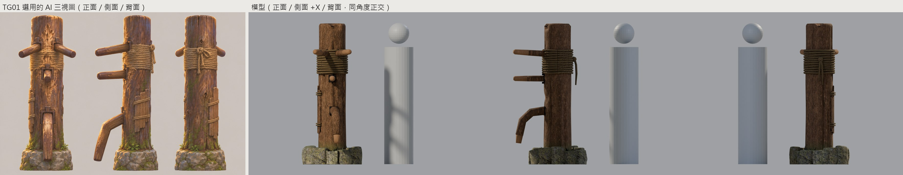

| 項目 | 內容 |
|---|---|
| 誰做的 | A（Johnnnny0823） |
| 工作包 | docs/execution/2026-11-14/A-120h-roads-yard-and-mountain-street.md（A 批，TG01 先交樣品） |
| ID | TG01 木人樁（TG02–TG06 之後在同一張 PR 補上） |
| 擺哪 | A1 青溪村，廣場東側的演武場（設定圖 `art/references/blocks/A1/` 的 V1、V3） |
| 分支／PR | art/a-1114-tg-rd-ts-yard-and-road ／ #119 |
| 版本 | v002（PR #119 審查後重做） |
| 狀態 | Exported；Imported：見「驗收紀錄」的 Unity 6000.3.28f1 檢查；Visually Verified：預覽圖；In-game Verified：未驗 |
| 素材來源 | 原創。建模腳本 `art/source/training-yard-a/build_tg.py`，沿用 MC01（#80）的建模函式；三視圖用 Codex CLI 生成，存 `art/references/TG01/` |

# 演武場重做：TG01 木人樁


## PR #119 審查修改（11/16 意見，2026-11-27 改）



| 意見 | 改法 |
|---|---|
| 1. 木頭是平滑的深咖啡色圓柱，像塑膠；要用掃描舊木／樹皮，裂縫做成形狀再烘焙 | 樁身改成 56 邊、58 圈的車床體，九道縱向深裂縫（深 2.5–5.5 cm，會微微彎；三道從樁頂裂下）、樁頂 V 形裂口、十一處打凹都是幾何。表面用 Poly Haven `bark_willow_02` 掃描：新增 `art/source/training-yard-a/bake_tg.py`，樁、手臂、腳、補丁木條、石座先平滑細分（每面 16 面）當高模，照掃描的位移貼圖再推 1.2 cm 細溝，用 Cycles 把法線和顏色烘到遊戲模型，一張 1024 圖（`T_TG01_Baked_*`，材質 `M_TG01_Baked`）。手臂和腳的末端烘成磨亮的深色，樁腳 25 cm 以下偏暗、帶苔 |
| 2. 樁身的補釘木條和下方的彎臂沒有或很簡化 | 補丁改成五片直木板（長 0.5–0.6 m、上緣錯落），用兩道雙股麻繩綁，位置照三視圖放在 −X 側（正面圖的左邊、背面圖的右邊）。下方的彎腳加長加粗：半徑 5.4 cm，從膝高伸出 0.3 m 再往下彎 0.4 m，末端到石座上方。麻繩也照三視圖加寬：11 圈，覆蓋 1.12–1.42 m，結和兩段繩尾在背面 |
| 3. 底座是整齊的灰色多邊形，要一圈長苔的不規則石塊 | 改用核心組 SS01 半埋踏石的 `rock()`（`core-d2-v1/d2_ground.py`，#118，照抄，只改解析度）：12 塊緊靠成一圈，每塊有 5–8 個斷裂面。表面用 Poly Haven `mossy_rock` 掃描烘焙，苔一塊塊長在朝上的面 |
| 4. 並排圖要同一個角度 | 新增 `TG01_threeview_same_angle.jpg`：三視圖的正面／側面／背面對模型的正面／側面（+X）／背面，正交、同順序 |

- 掃描來源：https://polyhaven.com/a/bark_willow_02 、https://polyhaven.com/a/mossy_rock ，CC0。原始掃描不放進 repo（`D:/yj-assets/polyhaven/`，或用環境變數 `BARK_SCANS` 指定）。
- 麻繩、鐵片、土心仍用演武場共用貼圖 `M_TrainingYard_Trim`。
- 樁身直徑從 0.31 m 改成 0.33 m，比較接近三視圖的粗細。
- 修過的問題：石座 12 塊靠得很緊，底面都在地面高度而互相重疊共面（QA 187 對）→ 拿掉埋在地下的底面；共用貼圖上 2 mm 寬的倒角面 UV 被壓成一條線（QA「UV 面積 0」）→ 匯出前把這種面的 UV 撐開一點。

## 做法（三視圖選 option 3）

- **樁身**：一根粗圓木（直徑 0.33 m、高 1.74 m），樁頂有 V 形裂口、缺一角。
  - 九道縱向深裂縫，其中三道從樁頂裂下來（#119 審查後加）。
  - 正面（練的人站的那面，−Y）在膝到胸的高度有十一處被打出來的凹痕。
- **手臂與腳**：
  - 上面兩支手臂往前斜伸、略往上，中間一支直伸，下面一支彎腳往前再往下。
  - 都穿過方榫口，榫口有深色鐵片和上下兩塊鐵楔。
  - 手臂和腳的末端烘成磨亮的深色，表示被手摸久了（工作包「握把磨亮」）。
- **麻繩**：手臂這一段纏 11 圈麻繩；背面打一個結，垂兩段繩尾。
- **補丁**：−X 側五片直木板，雙股麻繩綁兩道。
- **石座**：12 塊長苔的不規則石塊（核心組 SS01 的石頭）緊靠成一圈，中間是深色土；腳邊長苔。
- **和舊的不同**：舊的 training-yard-v1 只有直柱；這個有手臂、繩、裂、凹痕和磨亮，看得出用了很久。

## 演武場共用貼圖

新做一張 2048 共用貼圖 `art/textures/training-yard-a/T_TrainingYard_*`，材質 `M_TrainingYard_Trim`。

- **條帶排法**：和 MC01 共用貼圖相同，建模函式不用改。
- **顏色**：照河谷村子的用色（和 #113 的河谷貼圖一樣：灰藍河石、深色舊木、深色鐵件，不用山城的灰白花崗石和銅件）。
- **為 TG 系列重畫的條帶**：
  - 磨亮木：手臂末端、之後兵器架的握把。
  - 稻草：之後的箭靶。
  - 麻繩：一股股斜絞。
  - 舊布：之後的無字旗和遮陽棚，完全沒有字和圖案。
  - 深色鐵：取代銅件。
- TG02–TG06 都用這一張，可以合批。

## 原點與接法

- **原點**：樁的中心，z＝0 是地面；手臂朝 −Y。
- **接口**：`Socket_Front` 在樁前 0.6 m 的地面，是練的人站的位置。
- **碰撞**：兩個方塊：樁身一根、石座一圈。手臂不擋人。

## 數字

| ID | 尺寸 L×W×H（m） | LOD0 / LOD1 / LOD2 三角面 | 物件 | 材質 | 貼圖 | 碰撞 |
|---|---|---|---|---|---|---|
| TG01 | 0.745 × 0.917 × 1.747 | 21,988 / 10,994 / 3,303 | 2 | 2 | 共用 2048 × 4（Albedo、Normal、MetallicSmoothness、Emission）＋ 自己的 1024 × 2（`T_TG01_Baked_Albedo`、`_Normal`） | 一個網格（2 塊） |

- **物件**：主體一個（兩個材質：`M_TG01_Baked` 木頭與石座、`M_TrainingYard_Trim` 麻繩與鐵片），`Detail_Moss`（苔，可整組關掉）一個。
- **面數**：v001 是 6,760；這版裂縫和石塊要有形狀，LOD0 變成 21,988，仍在演武場小件的範圍內。
- **交付格式**：FBX 內含 LOD0/1/2、`TG01_Collision`、接口 empty。不帶切線，Unity 匯入時用 MikkTSpace 算。
- **效能**：不寫 FPS；手機未實測。

## 驗收紀錄

- **Blender 資產 QA**（blender-asset-qa `qa_check`，game profile，z-fighting／懸空都有跑）：
  - 主體 errors＝0；苔＋主體合併檢查，懸空＝0（#119 審查後重建再跑）。
  - 結果存 `art/source/training-yard-a/qa_all.json`。
- **FBX 回匯**：尺寸和建模時相同（誤差 0）。
- **Unity 6000.3.28f1**（`apps/game/Assets/YunJing/Editor/TrainingYardVerify.cs`）：15 項全部通過（#119 審查後；原本 14 項，加烘焙貼圖一項），報告在 `art/previews/training-yard-a/unity/report.txt`。
  - 一般匯入檢查：尺寸、面數、物件、材質、接口、LODGroup、碰撞。
  - #119 審查後加：`T_TG01_Baked_*` 匯入（原始 1024）、`M_TG01_Baked` 材質。
  - `Socket_Front` 在 −Z 側（練的人那邊）。
  - 從樁前 1 m、1.2 m 高往樁打射線，0.83 m 打到樁身碰撞。
  - 手臂伸到 z＝−0.52 m。
  - 站在練的人的位置、1.7 m 眼高的截圖在 `unity/modules/TG01-trainee-eye-1p7m.png`。
- **修過的問題**：
  - 樁底、土心、石塊底面都在 z＝0 而閃爍：樁底和土心往上抬 2–4 cm，石塊往下沉 1.2 cm。
  - 兩片補丁木條重疊、頂面同高：拉開、錯開高度。
  - 車床旋轉體的中心點半徑 0，產生退化面：改成在小半徑處收口。
- **還沒驗**：擺進 A1 演武場和設定圖比對（核心組擺放）、手機效能。

## 怎麼重跑

```
python tools/mountain-city-a/make_prompts_1114.py
python tools/mountain-city-a/gen_threeviews.py --prompts prompts_1114.json TG01
# 先下載 bark_willow_02、mossy_rock 的 2K diff／disp（polyhaven.com，CC0）到 D:/yj-assets/polyhaven/，或設 BARK_SCANS=<資料夾>
blender -b --factory-startup -P art/source/training-yard-a/build_tg.py -- sheet TG01
blender -b --factory-startup -P art/source/training-yard-a/qa_tg.py -- <絕對路徑 out.json> TG01
blender -b --factory-startup -P art/source/training-yard-a/render_tg.py -- --out <repo 絕對路徑>/art/previews/training-yard-a [--clay|--wire|--lod 1] TG01
python art/source/training-yard-a/sheets_tg.py TG01
Unity -batchmode -quit -projectPath apps/game -executeMethod YunJing.Editor.TrainingYardVerify.Run -logFile <log>
```

## 預覽

`art/previews/training-yard-a/`：

- **TG01**：
  - 3/4、側、正、俯視（含 1.75 m 人形尺）；
  - 灰模、線框、LOD1；
  - `TG01_ref_vs_model.jpg`：參考圖對模型；
  - `TG01_threeview_same_angle.jpg`：三視圖正面／側面／背面對模型同角度（#119 審查要求）；
  - `TG01_LOD0_vs_LOD1.jpg`。
- `unity/`：Unity 截圖與報告。

## 工時

約 2 小時（11/14，含讀包和設定圖、三視圖生成與選圖、演武場貼圖、建模、QA 修正、Unity 檢查），由 Claude Code 執行。
