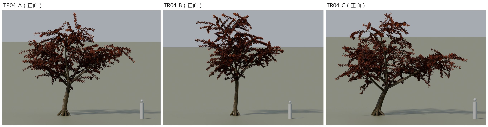
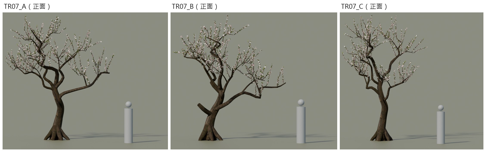
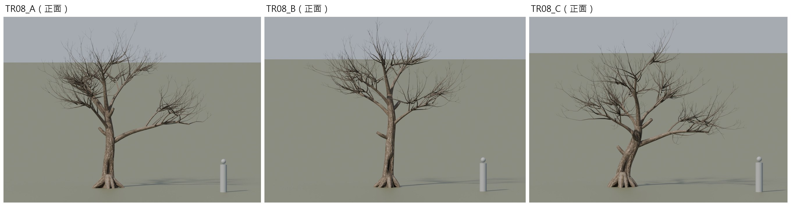
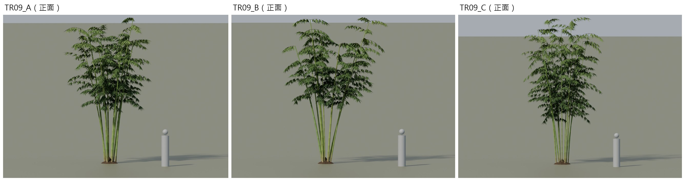
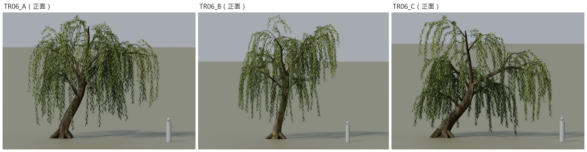

| 項目 | 內容 |
|---|---|
| 誰做的 | A（Johnnnny0823） |
| 工作包 | `docs/execution/2026-11-14/樹木重做-v2-分工.md`（feature/qingxi-creek-chapter 分支；A 負責 TR04／06／07／08／09 v002） |
| ID | TR04 楓、TR06 垂柳、TR07 梅、TR08 枯樹、TR09 竹叢，v002，每種變體 A、B、C（共 15 個） |
| 擺哪 | TR04：D3、A3；TR06：A1 溪邊、A3；TR07：A1 院子；TR08：A1、A9；TR09：A1 北側、A8 竹海 |
| 分支／PR | art/a-1114-tr-trees-v2-shaped ／ #120 |
| 版本 | v002 |
| 狀態 | Exported；Imported：見「驗收紀錄」的 Unity 6000.3.28f1 檢查；Visually Verified：預覽圖；In-game Verified：未驗 |
| 素材來源 | 原創。建模腳本 `art/source/trees-v2-a/build_tr.py`（Python 程序建模，照世界樹指南的順序）；三視圖用 Codex CLI 生成，存 `art/references/TR04／06／07／08／09/` |

# 樹木重做 v2：TR04 楓、TR06 垂柳、TR07 梅、TR08 枯樹、TR09 竹叢


## PR #120 審查修改（11/16 意見，2026-11-27 改）

| 意見 | 改法 | 看哪張圖 |
|---|---|---|
| 1. TR04 楓的葉子是平的方紙片、一叢叢黏在一起，紅色太亮太橘 | 葉子改成窄的五頂點立體葉（寬為長的 50–62%，長 15–22 cm），中脈拱高加倍，沿枝梢排（每錨點 12–16 股、沿枝外側 95% 長出）；色票壓成暗赭紅、鏽紅（最亮兩階約 `#6A2C1C`、`#7C3E26`；第一次用 `#8A4A2A` 當最亮，在 Unity 的太陽下受光面還是偏橘，再壓一階） | `TR04_*_under_canopy.jpg`、`TR04_variants.jpg` |
| 2. 樹皮是平滑的單色樹幹，要用 Poly Haven 掃描推進幾何再烘焙（竹子不用） | 新增 `art/source/trees-v2-a/bark_bake.py`：樹幹、主枝、次枝、根先平滑細分（每面 16 面）當高模，照掃描的 Displacement 把裂溝推進去（深度 = 枝半徑 × 0.38，樹幹約 7–11 cm，細枝 4 mm 起）；再用 Cycles 把高模的法線和顏色烘到遊戲模型，每棵一張 2048 樹皮圖。柳、楓、梅用 `bark_brown_02`，枯樹用 `bark_willow_02`；竹叢照意見不改 | `<ID>_bark_close.jpg`（樹幹近拍） |
| 3. 每種加一張灰霧背景（RGB 約 185,193,198） | `render_tr.py` 新增 `mist` 視角：透明背景加地面陰影，合成到 RGB 185,193,198 | `<ID>_mist.jpg`（15 張） |

- 掃描來源：https://polyhaven.com/a/bark_brown_02 、https://polyhaven.com/a/bark_willow_02 ，CC0。原始掃描不放進 repo（放 `D:/yj-assets/polyhaven/`，或用環境變數 `BARK_SCANS` 指定資料夾）。
- 細枝（3–4 邊的細管）仍用原本的程序樹皮 `T_TreeV2_Bark_*`：太細、烘了也看不出，而且數量多會佔滿圖集。
- 樹皮色調（`barkTint`）改成烘進貼圖：梅提亮到 (0.58, 0.50, 0.46)（原本 0.42 會把裂溝壓到看不見），枯樹改成銀灰 (0.92, 0.97, 1.06)（原本偏藍白）。Unity 的樹皮材質 `_BaseColor` 改為白色。
- 除錯紀錄：高模第一次用「不平滑」細分，留著低模的折面，和平滑著色的遊戲模型一比，差異被烘進法線圖，樹幹上出現一條條黑縫；改成平滑細分後消失。

## 五種樹一覽

| ID | 樹種 | 三視圖選用 | 重點 |
|---|---|---|---|
| TR06 | 垂柳 | option 1 | 先交的樣品。樹幹斜向水面，垂枝成束下垂，細長葉 |
| TR04 | 楓 | option 3 | 樹冠寬、水平分層的枝梢流，寬掌形葉，暗紅到鏽紅 |
| TR07 | 梅 | option 2 | 樹幹扭轉、主枝多折角，黑褐樹皮，花和小葉點綴不鋪滿 |
| TR08 | 枯樹 | option 1 | 沒有葉，三級枝加兩次分叉的細枝，低處樹洞，2–3 截斷枝，灰白樹皮 |
| TR09 | 竹叢 | option 5 | 9–13 支竹竿，有節、粗細不一，上半段出枝，葉子成串下垂；碰撞只用一個圓柱，方便密種 |

選圖理由都在各自的 `art/references/<ID>/prompt.txt`。五種樹共用同一支建模腳本 `build_tr.py`，依樹種切換枝梢流的長法、葉形、色票和樹皮色調（下面「其他四種樹的做法」）；竹叢的竹竿另寫一段（`build_bamboo`）。

## 做法：照世界樹指南的順序（以 TR06 為例）

指南是工作包附的 `tree-method/天空島世界樹建模歷程與精修方法.md`。每一步都在 `build_tr.py` 裡，順序如下：

1. **先看剪影**：三視圖選 option 1（理由在 `art/references/TR06/prompt.txt`），每個變體出三張黑剪影（正面、左右 35°）確認大形。
2. **S 形主幹**：7 個控制點。根部先往一側承重，中段往水面斜出，上段回拉。
   - 粗細不等速收細；
   - 根頸膨大成五瓣；
   - 有一個樹瘤；
   - 樹幹表面是 5 瓣＋9 瓣的扭轉稜，下段強、上段弱；
   - 表面根 6–8 條，壓進地面，末端埋到 −0.3 m。
3. **主枝**：先放 3 條決定剪影的枝，再補到 6–7 條，不對稱。
   - 一條長枝伸到水面上，負責最大跨度；
   - 一條往上，負責最高點；
   - 一條往岸上，負責另一側寬度；
   - 起點分散在樹幹 52%–100% 的高度，不從同一點散開。
4. **三級粗細**：主枝（半徑 0.10–0.16 m）→ 次枝（主枝的 55% 起）→ 垂枝（0.8 cm 收到 0.3 cm）。
5. **葉冠錨點**：A 19 個、B 17 個、C 15 個，分水面側（前）和岸側（後）兩層，大小、高度都不同。
6. **枝梢流（垂柳的重點）**：
   - 每個錨點 10–13 股垂枝，沿枝條外側 72% 長出（靠近樹幹的也有，才擋得住樹幹），先往上往外拱，再垂下來；
   - 每個錨點分成 3 束，束和束之間留空洞，看得到主枝和天空；
   - 垂枝的長度和下緣高度都不一樣，有的垂到離地 0.3 m，有的停在 2.2 m。
7. **五頂點立體葉**：四點輪廓加一個抬高的中脈，細長柳葉（長 24–34 cm、寬為長的 19–25%），沿垂枝參數 t 排列，和枝夾 28–55°，貼在垂枝的實際幾何上。
8. **頂點色**：
   - RGB 是五階柳綠，依葉子在樹冠裡的高度和內外連續混色：上、外亮而暖，下、內暗而冷，沒有色帶；
   - A 是樹冠遮蔽；
   - 顏色照工作包「沉穩、不要螢光綠」壓暗，比參考圖的黃綠暗。
9. **最後才做樹皮**（#120 審查後改）：Poly Haven `bark_brown_02` 掃描推進高模、烘到遊戲模型（`T_<ID>_Bark_Albedo`／`_Normal`，2048，見最上面「PR #120 審查修改」）。
   - 細枝仍用 1024 程序樹皮 `T_TreeV2_Bark_*`（腳本用 numpy 產生）；
   - 樹幹的大起伏（扭轉稜、樹瘤、根頸）靠幾何，裂溝靠掃描烘焙。

**沒有用的做法**（工作包禁止）：葉片卡、葉團圖集、在球體裡撒葉子、左右鏡像的枝、粗細一樣的枝。

## 其他四種樹的做法

順序和 TR06 一樣（剪影 → S 形主幹 → 主枝 → 三級枝 → 錨點 → 枝梢流 → 五頂點葉 → 頂點色 → 樹皮），只換下面這些：

### TR04 楓（三視圖 option 3）



- **主幹與主枝**：微斜的 S 形主幹，在 2.5–3 m 分成 5–6 支往上斜的主枝；長主枝有 3 支次枝。
- **枝梢流**：每個錨點 10–13 股，沿枝條外側 88% 長出。枝梢接近水平地展開、上下錯開，末端微垂，形成一層一層的樹冠，層間有空洞。
- **葉**（#120 審查後改）：窄的五頂點立體葉（寬為長的 50–62%，輪廓點在葉長 42%，中脈拱高 0.32），長 15–22 cm，一片片沿枝梢排。每棵約 1.11 萬片。
- **色票**（#120 審查後改）：暗栗紅 → 暗赭紅 → 赭紅 → 鏽紅，頂端受光處最亮（約 `#7C3E26`），沒有鮮紅、鮮橘。
- **樹皮**：`bark_brown_02` 掃描烘焙（`M_<ID>_Bark`），色調略偏冷灰；細枝 `M_TreeV2_Bark_Maple`。
- **改過的問題**：第一版葉子集中在枝尖成一片片平盤、中段光禿、顏色偏橘褐。改成枝梢沿更長段長出、上下展開，色票改暗紅。

### TR07 梅（三視圖 option 2）



- **主幹**：短、扭轉的 S 形主幹（約 2.1–2.7 m），分成兩支主幹。
- **主枝**：每支主枝用 8 個控制點、亂數偏移加大，做出梅枝的折角，不是圓滑的弧。
- **枝梢流**：短的直立新枝（0.4–1.2 m），每段有 30% 機會急轉，模仿梅的折枝。
- **花與葉**：每棵約 1,900 朵小花（淡粉、粉白、白，五頂點小花）、約 1,600 片小葉（5–8 cm），沿枝點綴，枝幹看得清楚，沒有鋪滿。
- **樹皮**：`bark_brown_02` 掃描烘焙、壓成黑褐（`M_<ID>_Bark`）；細枝 `M_TreeV2_Bark_Plum`。
- **面數**：LOD0 約 2.2 萬，因為工作包要「不鋪滿」，沒有把葉子堆到上限。
- **改過的問題**：第一版主枝太圓滑、表面根相對樹幹太大。加控制點做折角，根的長度改成隨樹幹粗細縮放。

### TR08 枯樹（三視圖 option 1）



- **主幹**：粗的 S 形主幹（底部半徑 0.31–0.37 m），根頸膨大。
- **樹洞**：低處的樹洞朝正面（-Y）。樹幹在洞的位置往內凹 78%，洞內頂點色壓暗。
- **斷枝**：每棵 2–3 截斷枝。
- **剪影**：一支主枝往側面斜出很遠，另一側收短。
- **細枝（三級層次）**：沒有葉子，枝就是全部，所以細枝做成會分叉的。每股細枝末端再分兩次叉，中段再分一次，分叉往上彎，形成一路變細的枝網。
- **樹皮**：`bark_willow_02` 掃描烘焙、調成銀灰（`M_<ID>_Bark`），表現風化的枯木；細枝 `M_TreeV2_Bark_Dead`。
- **LOD**：沒有葉子，LOD1、LOD2 是樹幹加細枝一起減面（LOD1 約為 LOD0 的 45%）。
- **改過的問題**：第一版細枝是一把直直的「掃帚」、樹洞太小、顏色太棕。改成分叉細枝、加大加深樹洞、樹皮調灰。

### TR09 竹叢（三視圖 option 5）



- **竹竿**：9–13 支，從同一個根盤長出（根盤埋到 −0.3 m）；竹竿根部互相保持 10 cm 以上，避免兩支互相穿插。
  - 粗細不一（直徑 3.6–8.8 cm），往上收細，微微往外拱；
  - 每 25–35 cm 一個節：節環略鼓、顏色略深；
  - 竹竿顏色在頂點色：綠到黃綠，老竹偏黃，最底下 0.6 m 是乾籜的黃褐。
- **枝與葉**：上半段（B、A 從一半高、C 從 42%）每節出 1–2 支枝，每支枝沿全長掛 5 串葉；每串是幾片細長竹葉（22–32 cm）往下垂。每叢約 8,500–9,000 片。
- **材質**：竹竿 `M_TreeV2_Bamboo`（讀頂點色）；枝和根盤用樹皮（`M_TreeV2_Bark_Bamboo`）；葉 `M_TreeV2_Leaf`。
- **能密種**：
  - 碰撞只有一個包住根部的 8 邊圓柱（高 2.2 m）；
  - LOD1 竹竿和枝一起減面，LOD1／LOD2／LOD3 和其他樹一樣在上限內。
- **改過的問題**：第一版葉子只在枝節上一小撮、整叢太稀。葉加大、每支枝掛 5 串、上半段每節出枝、竹竿加粗。

## TR06 的三個變體



| 變體 | 樣子 | 高度 | 種子 |
|---|---|---|---|
| A | 寬，樹幹斜向水面，長枝伸到水上（照三視圖 option 1） | 9.16 m | `zlib.crc32("TR06_A")` |
| B | 高而直，樹冠往上收 | 10.71 m | `zlib.crc32("TR06_B")` |
| C | 矮，樹幹斜得最多，有一截斷枝 | 8.84 m | `zlib.crc32("TR06_C")` |

亂數種子固定，重跑腳本會得到同一棵樹。

## 原點與方向

- **原點**：樹幹（竹叢是根盤）底部中心，z＝0 是地面，根往下埋 0.3 m。
- **傾斜方向**：+X。樹幹和長枝都斜向 +X（Unity 裡也是 +X）；TR06 擺放時 +X 朝水面。
- **碰撞**：
  - 樹：只有樹幹下段（8 邊管，約 3 m 高），枝和葉不擋人；
  - 竹叢：一個包住根部的 8 邊圓柱。

## 數字

| ID | 尺寸 L×W×H（m，含地下根） | 地上高度 | LOD0 / LOD1 / LOD2 / LOD3 三角面 | 主枝（竹竿） | 錨點 | 枝梢流 | 葉片（花） |
|---|---|---|---|---|---|---|---|
| TR04_A | 10.428 × 10.134 × 9.675 | 9.36 m | 59,125 / 14,600 / 3,900 / 4 | 6 | 20 | 273 | 11,075 |
| TR04_B | 8.661 × 9.253 × 10.589 | 10.27 m | 56,461 / 14,600 / 3,899 / 4 | 5 | 16 | 219 | 11,071 |
| TR04_C | 11.248 × 10.234 × 9.204 | 8.89 m | 59,883 / 14,598 / 3,900 / 4 | 6 | 20 | 271 | 11,214 |
| TR06_A | 9.630 × 9.077 × 9.483 | 9.16 m | 59,075 / 14,599 / 3,899 / 4 | 7 | 19（前 10／後 9） | 215 | 11,761 |
| TR06_B | 8.780 × 8.253 × 11.041 | 10.71 m | 58,391 / 14,600 / 3,899 / 4 | 6 | 17（前 9／後 8） | 199 | 11,853 |
| TR06_C | 9.942 × 9.256 × 9.183 | 8.84 m | 57,366 / 14,600 / 3,898 / 4 | 6 | 15（前 7／後 8） | 172 | 11,772 |
| TR07_A | 4.571 × 3.679 × 5.653 | 5.33 m | 22,580 / 9,370 / 3,900 / 4 | 5 | 15 | 122 | 1,593（1,924 朵） |
| TR07_B | 4.482 × 3.688 × 5.376 | 5.05 m | 22,150 / 9,342 / 3,899 / 4 | 5 | 14 | 106 | 1,614（1,937 朵） |
| TR07_C | 3.849 × 3.691 × 6.062 | 5.74 m | 22,071 / 9,024 / 3,899 / 4 | 5 | 12 | 101 | 1,573（2,012 朵） |
| TR08_A | 9.173 × 8.553 × 9.225 | 8.90 m | 48,324 / 14,600 / 3,899 / 4 | 6 | 18 | 170 | 0 |
| TR08_B | 8.648 × 7.760 × 9.165 | 8.83 m | 35,828 / 14,599 / 3,899 / 4 | 5 | 13 | 123 | 0 |
| TR08_C | 9.520 × 8.784 × 8.679 | 8.35 m | 43,000 / 14,600 / 3,899 / 4 | 5 | 15 | 150 | 0 |
| TR09_A | 4.217 × 4.283 × 7.184 | 6.88 m | 47,085 / 14,599 / 3,899 / 4 | （11 支） | 20 | 145 | 9,009 |
| TR09_B | 5.037 × 3.967 × 7.107 | 6.81 m | 43,535 / 14,599 / 3,900 / 4 | （9 支） | 20 | 127 | 8,562 |
| TR09_C | 4.360 × 4.395 × 7.836 | 7.54 m | 50,795 / 14,600 / 3,899 / 4 | （13 支） | 20 | 211 | 8,996 |

高度都在工作包範圍內：TR04、TR06 8–12 m，TR07 4–6 m，TR08 6–9 m，TR09 6–8 m。

- **工作包上限**：LOD0 ≤ 60,000、LOD1 ≤ 15,000、LOD2 ≤ 4,000、LOD3 ≤ 200，15 個都在內。
- **LOD 做法**：
  - LOD1：葉子減到四分之一、每片放大，拿掉垂枝細管，樹幹和主枝減面；
  - LOD2：葉子減到十六分之一、再放大，仍是立體葉，沒有用卡片；
  - LOD3：兩張十字交叉的遠景卡，貼圖是 LOD0 的正、側投影（`T_<ID>_Far`，1024 × 512，alpha）。
- **材質**：
  - 樹幹與枝：`M_<ID>_Bark`（TR04／06／07／08 的 12 棵），每棵自己的 2048 掃描烘焙圖，色調已烘進去（model_info 的 `barkScan`、`barkTint`）；
  - 細枝與竹叢的枝、根盤：`M_TreeV2_Bark`（TR06）、`_Maple`、`_Plum`、`_Dead`、`_Bamboo`，共用 1024 程序樹皮，只差色調，Unity 用 `_BaseColor`；
  - `M_TreeV2_Leaf`：葉和梅花，讀頂點色，不透明、雙面、粗糙 0.86；
  - `M_TreeV2_Bamboo`：竹竿，讀頂點色；
  - `M_<ID>_Far`：只有 LOD3 用。
- **貼圖**：各棵的 `T_<ID>_Bark_Albedo`、`T_<ID>_Bark_Normal`（2048，竹叢沒有）；`T_TreeV2_Bark_Albedo`、`T_TreeV2_Bark_Normal`（1024，細枝共用）；各棵的 `T_<ID>_Far`。
- **風**：UV2.x 寫風權重。主幹 0，主枝 0.05–0.3，次枝 0.3–0.55，垂枝 0.55–0.9，葉 0.9–1.0；UV2.y 是錨點相位。
- **交付格式**：FBX 內含 LOD0–3 和 `<ID>_Collision`。不帶切線，Unity 匯入時用 MikkTSpace 算。
- **效能**：不寫 FPS；手機未實測。

> **給核心組**：葉色在頂點色裡，遊戲裡的葉材質要讀頂點色（RGB 當顏色、A 當遮蔽）和 UV2.x（風）。竹竿也一樣。現有的 `YunJing/QingxiFoliageWind` 會把頂點色紅色當成風權重、也不乘頂點色，不能直接用。這次 Unity 檢查暫用 URP 內建的 `Particles/Simple Lit` 預覽，沒有新增 shader。用哪個葉材質請核心組決定。

## 驗收（工作包第 3 節）

每種樹都有同一組圖（`<ID>_vs_standard.jpg`、`<ID>_silhouettes.jpg`、`<ID>_*_under_canopy.jpg`、`<ID>_*_far_*`），下面以 TR06 說明，其他四種的差異寫在「其他四種樹的做法」和自評。

1. **和標準圖並排**（同光，正面、左右 35°）：見最上面的圖，檔案 `TR06_vs_standard.jpg`。
   - 做到的：
     - 一片一片的立體小葉；
     - 葉子沿垂枝排列；
     - 看得到主枝、次枝、垂枝三層；
     - 樹冠有大小不同的空洞。
   - 和標準圖不同的地方：標準圖是闊葉樹、葉團厚，垂柳的葉冠本來就比較透。
2. **黑剪影三張**：`TR06_silhouettes.jpg`，每個變體正面、左右 35°。三個都偏向水面那側、不對稱，垂枝束之間有空洞。
3. **樹冠下往上看**：`TR06_*_under_canopy.jpg`。看得到垂枝從次枝後段長出、穿進葉子裡。
4. **遠看 20 m、60 m**：
   - Blender：`TR06_*_far_20m_LOD0／LOD1`、`far_60m_LOD1／LOD2`；
   - Unity：`unity/TR06_*-eye-20m-lodgroup`、`-eye-60m-lodgroup`，由 LODGroup 自動切換。
   - 靜態截圖沒有糊；會不會閃要在遊戲裡動態看，**未驗**。
5. **指南第四節檢查表**：見下一節。

## 指南第四節檢查表

（以 TR06 逐項打勾；其他四種相同的項目不重複，不同的寫在最後「其他四種的差異」。）

**大形**
- [x] 關閉材質後仍有重心與剪影（`TR06_*_clay_three_quarter.jpg`、剪影圖）。
- [x] 主幹不是直柱，沒有硬折角（7 點 S 曲線）。
- [x] 三條主枝分別負責左右跨度、最高點、前後厚度。
- [x] 左右不鏡像，葉冠有大小不同的空洞。
- [ ] 縮到實際遊戲畫面尺寸仍看得出主枝：20 m 看得出；實際遊戲鏡頭**未驗**（核心組擺放後再看）。

**枝幹**
- [x] 主幹、主枝、次枝、垂枝粗細階級清楚。
- [x] 分叉處沒有平均鼓包或夾縮：主枝根部有 25% 的膨大，往外收細。
- [x] 末梢枝真的進入葉冠（樹冠下仰視圖）。
- [x] 少量斷枝、樹瘤、局部膨脹：每個變體一個樹瘤，C 多一截斷枝；沒有鋪滿。

**葉冠**
- [x] 葉子沿枝梢流分布，不是球體亂撒。
- [x] 前後葉冠分層（錨點分水面側和岸側），轉 35° 仍有厚度。
- [x] 主要葉叢厚、外圍疏，邊緣不是規則圓球。
- [x] 葉色依高度、內外連續變化，沒有硬色帶。
- [x] 葉片表示法符合平台：五頂點立體葉，LOD0 每棵約 1.1–1.2 萬片。

**根與地形**
- [x] 主根壓入地面（表面根末端埋到 −0.25 m）。
- [ ] 垂根沿岩壁取樣：不適用（溪邊平地，沒有岩壁）。擺到溪岸後要不要貼地形，等核心組擺放。
- [x] 根有主次：根頸五瓣膨大、6–8 條表面根，粗細不同。
- [ ] 根部接觸處的遮蔽：樹皮頂點色 A 有根部遮蔽；遊戲裡的接地陰影**未驗**。

**材質**
- [x] 樹皮高粗糙（0.92）、不帶金屬，色差低。
- [x] 中尺度起伏（扭轉稜、樹瘤、根頸）用幾何做，比樹皮紋路先做。
- [x] 葉片粗糙 0.86，不靠鏡面反光。
- [x] 不適用：沒有瀑布、雲。

**遊戲資產**
- [x] 亂數種子固定，可重建。
- [x] 掛點名稱穩定：這棵樹沒有掛點；物件名固定 `TR06_*_LOD0–3`、`_Collision`。
- [x] 葉片整併成網格，沒有輸出成大量獨立物件（每個 LOD 一個物件）。
- [x] FBX、建模腳本、model_info、Unity 檢查同步更新。
- [ ] 實際裝置量測：**未做**（手機未實測）。

**證據**
- [x] 同相機、同光線的前後圖：預覽都用同一套燈光和相機重出。
- [x] 正面、左右 35°、剪影、根部（灰模、3/4 圖）。
- [ ] 風動來自引擎實際畫面：**未做**。風權重已寫進 UV2，但沒有可讀它的葉材質，所以沒有動態畫面。
- [x] 測試通過、美術通過、真機通過分開記錄：測試見下一節，美術等審查，真機未做。

**其他四種的差異**
- TR04：分叉處的鼓包用同一套主枝膨大；葉冠分層靠水平枝梢流。
- TR07：葉片表示法改成小葉加五頂點小花，數量刻意少（「不鋪滿」）。
- TR08：沒有葉冠，葉冠相關項目改看細枝：細枝三級（主枝 → 次枝 → 細枝再分兩次叉）穿插成枝網。樹洞朝正面，斷枝 2–3 截。
- TR09：沒有樹幹、主枝。「主幹不是直柱」改看竹竿：每支微微外拱、粗細不一，節的間距往上變大。碰撞是一個圓柱。

## 自評（《雲境》建模總指令六項）

### 五種樹總表

| ID | 剪影（25） | 結構（20） | 材質（20） | 風格（15） | 動畫（10） | 效能（10） | 合計 | 主要差距 |
|---|---|---|---|---|---|---|---|---|
| TR06 垂柳 | 19 | 15 | 14 | 10 | 4 | 8 | **70** | 樹幹比參考圖細、扭轉淡；樹皮有掃描裂溝了，但還沒有苔 |
| TR07 梅 | 17 | 14 | 13 | 10 | 4 | 8 | **66** | 花太小、遠看幾乎看不出；樹幹少了節瘤和裂口 |
| TR04 楓 | 15 | 15 | 12 | 9 | 4 | 7 | **62** | 葉子改成沿枝的立體小葉、顏色壓成鏽紅；樹冠仍是一股股枝梢，不像參考圖成團的葉；樹幹偏細 |
| TR09 竹叢 | 16 | 14 | 11 | 9 | 4 | 8 | **62** | 竹竿偏細、葉團比參考圖暗而薄（這次沒改） |
| TR08 枯樹 | 15 | 14 | 12 | 8 | 4 | 8 | **61** | 樹皮換成柳樹皮掃描、裂溝有深度；但樹幹仍比參考圖細、直，樹洞在正面不夠明顯 |

括號外是這次（#120 審查後）的分數；修改前是 TR06 68、TR07 64、TR09 62、TR08 58、TR04 56。材質分加的是掃描樹皮，TR04 另外加在結構（單片葉）和風格（顏色）。

- **動畫**：五種都一樣是 4 分。風權重已寫進 UV2，但沒有讀它的葉材質，沒有看過實際風動。
- **效能**：都在 LOD 上限內、Unity 檢查全過，手機沒測。TR04 接近 6 萬面又是寬冠，多棵並排時最吃效能，所以扣 1 分。

**適不適合放進遊戲**：
- TR06、TR07、TR09 可以當中景（15–40 m）用。
- TR04 這次改完可以當中景用；TR08 還是建議先加粗、加扭樹幹再用。
- 5 m 內近看，五種都還達不到 A1 設定圖的完成度。

### TR06 垂柳細項

| 項目（權重） | 分數 | 根據 |
|---|---|---|
| 剪影與比例（25） | 19 | 斜向水面、不對稱、垂枝束間有空洞，三個變體分得出來；但樹幹比參考圖細、扭轉淡，樹冠頂有幾股往上翹的垂枝 |
| 拓撲與結構（20） | 15 | 三級枝清楚、葉子貼在垂枝上、QA 錯誤 0；但枝和樹幹是插入式接合（沒有焊接的分叉），垂枝是三邊細管 |
| 材質與光影（20） | 14 | 頂點色高度漸層有效；樹皮換成掃描烘焙、裂溝有深度（#120 審查後 +2）；葉片偏平面感、顏色範圍窄，還沒有苔和分叉處的暗部 |
| 風格一致（15） | 10 | 形體符合 A1 設定圖 V5 的溪邊柳樹；設定圖的柳樹更亮、更密、偏暖黃綠，這版照工作包壓暗，所以比設定圖沉 |
| 動畫與互動（10） | 4 | 風權重已寫進 UV2，但沒有讀它的葉材質，沒有看過實際風動 |
| 效能與匯出（10） | 8 | LOD0–3 都在上限內、Unity 檢查全過；手機沒測，一棵近 6 萬面，溪邊種很多棵時要靠 LOD |
| **合計** | **70／100** | |

**適不適合放進遊戲**：
- 適合當 A1 溪邊的中景樹（15–40 m）：這個距離看得出垂柳的形和垂枝層次，沒有葉片卡、球冠這些問題。
- 近看（5 m 內）還不夠：葉片是一片片平的菱形、樹幹太光滑，和設定圖的完成度有差距。
- 要放進遊戲畫面，最需要的三件事：
  1. 讀頂點色、帶一點透光和風動的葉材質（核心組決定）；
  2. 樹幹分叉處和根部加苔和暗部（掃描樹皮已做）；
  3. 樹幹再粗一點、扭一點，更接近參考圖。

## 驗收紀錄

- **Blender 資產 QA**（blender-asset-qa `qa_check`，game profile，z-fighting／懸空都有跑），15 個 LOD0：
  - 全部 errors＝0、懸空＝0（#120 審查後 2026-11-27 重建再跑一次，結果相同）。結果存 `art/source/trees-v2-a/qa_all.json`。
  - 預期中的警告（TR04_B、TR06_B 另有 1 對背靠背的面，不影響畫面）：
    - UV 重疊約 100%：一萬片葉子共用同一塊 UV。葉子只用頂點色、不用貼圖，所以重疊沒有影響。
    - 重複頂點：管子 UV 接縫要分開頂點。
    - 最低點 −0.32 m：根照工作包埋到地下。
  - QA 的 UV 重疊掃描要把每片葉子的 UV 正方形逐格掃過，一萬片會跑不完，所以只在 QA 用的複本上把葉子 UV 縮小再掃。交付的 FBX 沒有改。
- **FBX 回匯**：尺寸和建模時相同（誤差 0）。
- **Unity 6000.3.28f1**（`apps/game/Assets/YunJing/Editor/TreesV2Verify.cs`）：#120 審查後 244 項全部通過（原本 232 項，加 12 棵的掃描樹皮貼圖檢查），報告在 `art/previews/trees-v2-a/unity/report.txt`。
  - 掃描樹皮圖交 2048（`art/textures/trees-v2-a/T_<ID>_Bark_*`）；遊戲裡照專案的 `QingxiImportBudget`（網頁版下載預算）一律壓到 1024，檢查寫的是「原始 2048、遊戲內上限 1024」。要在遊戲裡用 2048，需要核心組放寬那條預算規則。
  - 每個變體（15 個）：
    - 尺寸、高度（依樹種的工作包範圍）、根埋 0.3 m；
    - LOD0–3 面數，在工作包上限內；
    - 材質（樹幹用各棵的掃描烘焙圖；細枝依 model_info 的色調）、四層 LODGroup；
    - 碰撞：從 3 m 外瞄準 1 m 高處的樹幹中心打射線，會打到樹幹（竹叢是根部圓柱）。
  - 頂點資料：
    - LOD0 每個頂點都有 UV2 和頂點色；
    - 樹幹底部 90% 以上的頂點風權重 ≤ 0.05；竹叢是竹竿，門檻 0.13（竹竿從根部的 0 往上漸增）；
    - 所有葉子頂點 ≥ 0.85；
    - 葉子 A 通道的遮蔽有變化（差距 > 0.2），葉色有變化；
    - 枯樹沒有葉子，葉子項目跳過並記在報告。
  - 中途修過的檢查條件：梅的樹幹在 1 m 高處偏離中心，射線原本固定打原點會落空，改成瞄準樹幹中心；梅樹冠小，遮蔽差距只有 0.28，門檻從 0.3 改 0.2。
  - 截圖：3/4、正面、樹冠下仰視，20 m、60 m 人眼高（LODGroup 自動切換）。
- **修過的問題**：
  - **共面閃爍（楓、梅、枯樹、竹叢）**：
    - 原因：同一點長出的葉片、兩支互相穿插的竹竿、同一路徑的細枝，面剛好平行重疊；
    - 修法一：竹竿根部保持間距；次枝、細枝的截面隨機轉角；
    - 修法二：建模後自動檢查（`resolve_coplanar`，門檻比 QA 還寬，因為 FBX 匯出再匯入會有一點精度誤差）。重疊的葉子以葉柄到葉尖為軸轉 0.15 弧度，葉柄不離開枝；重疊的枝面沿法線推出 1.5 mm；
    - 修法三：TR08_A、TR08_B、TR09_A 三棵仍各剩 1–3 對，改用另一個固定亂數種子（model_info 的 `seedSalt`）重建後乾淨；
    - TR06 沒有套用，維持審查過的版本（本來就沒有共面）。
  - 加亂數時一度讓葉柄離開細枝，QA 判成懸空：改成只沿枝的方向挪動。
  - 第一版葉子 10 cm 太小，整棵像光禿的枝：改成 20–30 cm 的細長葉，垂枝改成成束。
  - 主枝都從樹幹頂同一點散開（指南說的平均分叉）：起點分散到不同高度。
  - 次枝末端光禿成尖刺，葉子只長在枝尖：垂枝改成沿枝條後段 45% 長出。
  - 葉子和垂枝的幾何差 1–2 cm，QA 判成懸空：葉柄改貼在實際的垂枝幾何上。
  - 一條表面根的起點和根頸的面重合，閃爍：根的起點往樹幹內收。
  - C 的斷枝封口連錯頂點：修正索引。
  - 第一版樹冠太透、整段樹幹都看得到（使用者看過後要求葉子多一點、不要看到樹幹）：
    - 葉子加大到 24–34 cm，每棵多約 1,000 片；
    - 垂枝改成沿枝條外側 72% 長出，靠近樹幹的位置也有；
    - 每個錨點至少 10 股，下緣放低；
    - 垂枝細管改成每 0.96 m 取一點，省下的面數給葉子。
  - 另外試過加 3 條從樹幹中段往下垂的低枝，把樹幹整段擋住；使用者看過後覺得沒有加低枝的版本好看，所以沒有採用。
- **和參考圖的已知差異**（`TR06_ref_vs_model.jpg`）：
  - 樹冠已經加密（見「修過的問題」）；樹幹斜出樹冠的下段和中段仍看得到，和參考圖一樣。要再密就會超過 LOD0 6 萬面的上限。
  - 參考圖的樹幹更粗、更扭。模型的扭轉稜和樹瘤比較淡。
  - 葉色比參考圖暗，是照工作包要求壓暗的。
  - 需要調整請在審查裡說。
- **還沒驗**：
  - 擺進 A1 溪邊和設定圖比對（核心組擺放）；
  - 遊戲裡的風動和閃爍；
  - 手機效能。

## 怎麼重跑

```
python tools/mountain-city-a/make_prompts_tr.py
python tools/mountain-city-a/gen_threeviews.py --prompts prompts_tr.json TR04 TR06 TR07 TR08 TR09
# 先下載 bark_brown_02、bark_willow_02 的 2K diff／nor_gl／rough／disp（polyhaven.com，CC0）到 D:/yj-assets/polyhaven/，或設 BARK_SCANS=<資料夾>
blender -b --factory-startup -P art/source/trees-v2-a/build_tr.py -- bark
blender -b --factory-startup -P art/source/trees-v2-a/build_tr.py -- TR04_A TR04_B TR04_C TR06_A ... TR09_C   (15 個)
blender -b --factory-startup -P art/source/trees-v2-a/qa_tr.py -- <絕對路徑 out.json> TR04_A ... TR09_C
blender -b --factory-startup -P art/source/trees-v2-a/render_tr.py -- --out art/previews/trees-v2-a TR04_A ... TR09_C
python art/source/trees-v2-a/sheets_tr.py --standard <標準-天空島世界樹.png> TR04 TR06 TR07 TR08 TR09
Unity -batchmode -quit -projectPath apps/game -executeMethod YunJing.Editor.TreesV2Verify.Run -logFile <log>
```

## 預覽

`art/previews/trees-v2-a/`：

- **對照圖**（每種樹一組，`<ID>` = TR04／06／07／08／09）：
  - `<ID>_vs_standard.jpg`：和標準圖並排；
  - `<ID>_ref_vs_model.jpg`：和選用的三視圖並排；
  - `<ID>_silhouettes.jpg`：剪影；
  - `<ID>_variants.jpg`：三變體。
- **每個變體**：
  - 3/4、正面、左右 35°、側面、俯視（含 1.75 m 人形尺）；
  - 黑剪影；
  - 灰模、線框；
  - 樹冠下仰視；
  - 20 m、60 m；
  - LOD0–3 並排。
- `unity/`：Unity 截圖與報告。

## 工時

- TR06：約 3 小時（11/14，含讀工作包和指南、三視圖、樹皮貼圖、建模與三輪修改、QA、Unity 檢查）。
- TR04、TR07、TR08、TR09：約 6 小時（11/15，含四種三視圖與選圖、把腳本改成依樹種切換、竹叢另寫、每種兩到三輪修改、共面問題的四輪修正、QA、Unity 檢查）。
- 都由 Claude Code 執行。
