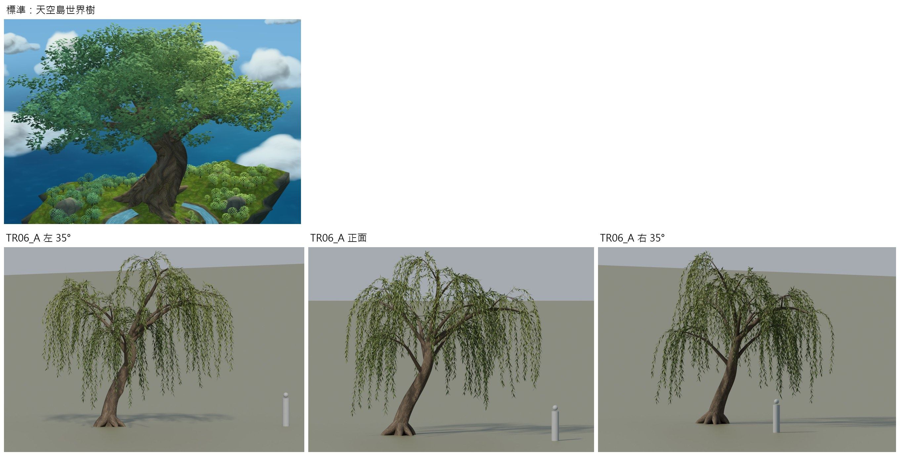

| 項目 | 內容 |
|---|---|
| 誰做的 | A（Johnnnny0823） |
| 工作包 | `docs/execution/2026-11-14/樹木重做-v2-分工.md`（feature/qingxi-creek-chapter 分支；A 負責 TR04／06／07／08／09 v002，TR06 先交樣品） |
| ID | TR06 垂柳 v002，變體 A、B、C（TR04、TR07、TR08、TR09 審查過再補在同一張 PR） |
| 擺哪 | A1 溪邊（設定圖 V5 溪邊小路）、A3 |
| 分支／PR | art/a-1114-tr-trees-v2-shaped ／ 待開 |
| 版本 | v002 |
| 狀態 | Exported；Imported：見「驗收紀錄」的 Unity 6000.3.28f1 檢查；Visually Verified：預覽圖；In-game Verified：未驗 |
| 素材來源 | 原創。建模腳本 `art/source/trees-v2-a/build_tr.py`（Python 程序建模，照世界樹指南的順序）；三視圖用 Codex CLI 生成，存 `art/references/TR06/` |

# 樹木重做 v2：TR06 垂柳（樣品）



## 做法：照世界樹指南的順序

指南是工作包附的 `tree-method/天空島世界樹建模歷程與精修方法.md`。每一步都在 `build_tr.py` 裡，順序如下：

1. **先看剪影**：三視圖選 option 1（理由在 `art/references/TR06/prompt.txt`），每個變體出三張黑剪影（正面、左右 35°）確認大形。
2. **S 形主幹**：7 個控制點。根部先往一側承重，中段往水面斜出，上段回拉。
   - 粗細不等速收細；
   - 根頸膨大成五瓣；
   - 有一個樹瘤；
   - 樹幹表面是 5 瓣＋9 瓣的扭轉稜，下段強、上段弱；
   - 表面根 6–8 條，壓進地面，末端埋到 −0.3 m。
3. **主枝**：先放 3 條決定剪影的枝，再補到 6–7 條，不對稱。
   - 一條長枝伸到水面上，負責最大跨度；
   - 一條往上，負責最高點；
   - 一條往岸上，負責另一側寬度；
   - 起點分散在樹幹 52%–100% 的高度，不從同一點散開。
4. **三級粗細**：主枝（半徑 0.10–0.16 m）→ 次枝（主枝的 55% 起）→ 垂枝（0.8 cm 收到 0.3 cm）。
5. **葉冠錨點**：A 19 個、B 17 個、C 15 個，分水面側（前）和岸側（後）兩層，大小、高度都不同。
6. **枝梢流（垂柳的重點）**：
   - 每個錨點 7–13 股垂枝，沿枝條後段 45% 長出，先往上往外拱，再垂下來；
   - 每個錨點分成 3 束，束和束之間留空洞，看得到主枝和天空；
   - 垂枝的長度和下緣高度都不一樣，有的垂到離地 0.4 m，有的停在 2.5 m。
7. **五頂點立體葉**：四點輪廓加一個抬高的中脈，細長柳葉（長 20–30 cm、寬為長的 17–23%），沿垂枝參數 t 排列，和枝夾 28–55°，貼在垂枝的實際幾何上。
8. **頂點色**：
   - RGB 是五階柳綠，依葉子在樹冠裡的高度和內外連續混色：上、外亮而暖，下、內暗而冷，沒有色帶；
   - A 是樹冠遮蔽；
   - 顏色照工作包「沉穩、不要螢光綠」壓暗，比參考圖的黃綠暗。
9. **最後才做樹皮**：1024 樹皮貼圖 `T_TreeV2_Bark_*`（腳本用 numpy 產生）。
   - 縱向交錯的淺溝紋，低對比、高粗糙（0.92），少量地衣斑；
   - 樹幹的大起伏靠幾何，不靠貼圖。

**沒有用的做法**（工作包禁止）：葉片卡、葉團圖集、在球體裡撒葉子、左右鏡像的枝、粗細一樣的枝。

## 三個變體


| 變體 | 樣子 | 高度 | 種子 |
|---|---|---|---|
| A | 寬，樹幹斜向水面，長枝伸到水上（照三視圖 option 1） | 9.24 m | `zlib.crc32("TR06_A")` |
| B | 高而直，樹冠往上收 | 10.72 m | `zlib.crc32("TR06_B")` |
| C | 矮，樹幹斜得最多，有一截斷枝 | 8.92 m | `zlib.crc32("TR06_C")` |

亂數種子固定，重跑腳本會得到同一棵樹。

## 原點與方向

- **原點**：樹幹底部中心，z＝0 是地面，根往下埋 0.3 m。
- **水面方向**：+X。樹幹和長枝都斜向 +X，擺放時 +X 朝水面（Unity 裡也是 +X）。
- **碰撞**：只有樹幹下段（8 邊管，約 3 m 高），垂枝和葉子不擋人。

## 數字

| ID | 尺寸 L×W×H（m，含地下根） | LOD0 / LOD1 / LOD2 / LOD3 三角面 | 主枝 | 錨點（前／後） | 垂枝 | 葉片 |
|---|---|---|---|---|---|---|
| TR06_A | 9.794 × 9.000 × 9.563 | 57,187 / 14,599 / 3,899 / 4 | 7 | 19（10／9） | 199 | 10,872 |
| TR06_B | 9.243 × 8.049 × 11.046 | 55,502 / 14,600 / 3,900 / 4 | 6 | 17（9／8） | 180 | 10,761 |
| TR06_C | 10.440 × 9.499 × 9.264 | 54,949 / 14,600 / 3,900 / 4 | 6 | 15（7／8） | 163 | 10,858 |

- **工作包上限**：LOD0 ≤ 60,000、LOD1 ≤ 15,000、LOD2 ≤ 4,000、LOD3 ≤ 200，三個變體都在內。
- **LOD 做法**：
  - LOD1：葉子減到四分之一、每片放大，拿掉垂枝細管，樹幹和主枝減面；
  - LOD2：葉子減到十六分之一、再放大，仍是立體葉，沒有用卡片；
  - LOD3：兩張十字交叉的遠景卡，貼圖是 LOD0 的正、側投影（`T_TR06_*_Far`，1024 × 512，alpha）。
- **材質**：
  - `M_TreeV2_Bark`：樹幹和枝；
  - `M_TreeV2_Leaf`：葉，讀頂點色，不透明、雙面、粗糙 0.86；
  - `M_TR06_*_Far`：只有 LOD3 用。
- **貼圖**：`T_TreeV2_Bark_Albedo`、`T_TreeV2_Bark_Normal`（1024，之後 TR04、07、08 共用），`T_TR06_A/B/C_Far`。
- **風**：UV2.x 寫風權重。主幹 0，主枝 0.05–0.3，次枝 0.3–0.55，垂枝 0.55–0.9，葉 0.9–1.0；UV2.y 是錨點相位。
- **交付格式**：FBX 內含 LOD0–3 和 `TR06_*_Collision`。不帶切線，Unity 匯入時用 MikkTSpace 算。
- **效能**：不寫 FPS；手機未實測。

> **給核心組**：葉色在頂點色裡，遊戲裡的葉材質要讀頂點色（RGB 當顏色、A 當遮蔽）和 UV2.x（風）。現有的 `YunJing/QingxiFoliageWind` 會把頂點色紅色當成風權重、也不乘頂點色，不能直接用。這次 Unity 檢查暫用 URP 內建的 `Particles/Simple Lit` 預覽，沒有新增 shader。用哪個葉材質請核心組決定。

## 驗收（工作包第 3 節）

1. **和標準圖並排**（同光，正面、左右 35°）：見最上面的圖，檔案 `TR06_vs_standard.jpg`。
   - 做到的：
     - 一片一片的立體小葉；
     - 葉子沿垂枝排列；
     - 看得到主枝、次枝、垂枝三層；
     - 樹冠有大小不同的空洞。
   - 和標準圖不同的地方：標準圖是闊葉樹、葉團厚，垂柳的葉冠本來就比較透。
2. **黑剪影三張**：`TR06_silhouettes.jpg`，每個變體正面、左右 35°。三個都偏向水面那側、不對稱，垂枝束之間有空洞。
3. **樹冠下往上看**：`TR06_*_under_canopy.jpg`。看得到垂枝從次枝後段長出、穿進葉子裡。
4. **遠看 20 m、60 m**：
   - Blender：`TR06_*_far_20m_LOD0／LOD1`、`far_60m_LOD1／LOD2`；
   - Unity：`unity/TR06_*-eye-20m-lodgroup`、`-eye-60m-lodgroup`，由 LODGroup 自動切換。
   - 靜態截圖沒有糊；會不會閃要在遊戲裡動態看，**未驗**。
5. **指南第四節檢查表**：見下一節。

## 指南第四節檢查表

**大形**
- [x] 關閉材質後仍有重心與剪影（`TR06_*_clay_three_quarter.jpg`、剪影圖）。
- [x] 主幹不是直柱，沒有硬折角（7 點 S 曲線）。
- [x] 三條主枝分別負責左右跨度、最高點、前後厚度。
- [x] 左右不鏡像，葉冠有大小不同的空洞。
- [ ] 縮到實際遊戲畫面尺寸仍看得出主枝：20 m 看得出；實際遊戲鏡頭**未驗**（核心組擺放後再看）。

**枝幹**
- [x] 主幹、主枝、次枝、垂枝粗細階級清楚。
- [x] 分叉處沒有平均鼓包或夾縮：主枝根部有 25% 的膨大，往外收細。
- [x] 末梢枝真的進入葉冠（樹冠下仰視圖）。
- [x] 少量斷枝、樹瘤、局部膨脹：每個變體一個樹瘤，C 多一截斷枝；沒有鋪滿。

**葉冠**
- [x] 葉子沿枝梢流分布，不是球體亂撒。
- [x] 前後葉冠分層（錨點分水面側和岸側），轉 35° 仍有厚度。
- [x] 主要葉叢厚、外圍疏，邊緣不是規則圓球。
- [x] 葉色依高度、內外連續變化，沒有硬色帶。
- [x] 葉片表示法符合平台：五頂點立體葉，LOD0 每棵約 1.1 萬片。

**根與地形**
- [x] 主根壓入地面（表面根末端埋到 −0.25 m）。
- [ ] 垂根沿岩壁取樣：不適用（溪邊平地，沒有岩壁）。擺到溪岸後要不要貼地形，等核心組擺放。
- [x] 根有主次：根頸五瓣膨大、6–8 條表面根，粗細不同。
- [ ] 根部接觸處的遮蔽：樹皮頂點色 A 有根部遮蔽；遊戲裡的接地陰影**未驗**。

**材質**
- [x] 樹皮高粗糙（0.92）、不帶金屬，色差低。
- [x] 中尺度起伏（扭轉稜、樹瘤、根頸）用幾何做，比樹皮紋路先做。
- [x] 葉片粗糙 0.86，不靠鏡面反光。
- [x] 不適用：沒有瀑布、雲。

**遊戲資產**
- [x] 亂數種子固定，可重建。
- [x] 掛點名稱穩定：這棵樹沒有掛點；物件名固定 `TR06_*_LOD0–3`、`_Collision`。
- [x] 葉片整併成網格，沒有輸出成大量獨立物件（每個 LOD 一個物件）。
- [x] FBX、建模腳本、model_info、Unity 檢查同步更新。
- [ ] 實際裝置量測：**未做**（手機未實測）。

**證據**
- [x] 同相機、同光線的前後圖：預覽都用同一套燈光和相機重出。
- [x] 正面、左右 35°、剪影、根部（灰模、3/4 圖）。
- [ ] 風動來自引擎實際畫面：**未做**。風權重已寫進 UV2，但沒有可讀它的葉材質，所以沒有動態畫面。
- [x] 測試通過、美術通過、真機通過分開記錄：測試見下一節，美術等審查，真機未做。

## 驗收紀錄

- **Blender 資產 QA**（blender-asset-qa `qa_check`，game profile，z-fighting／懸空都有跑），三個變體的 LOD0：
  - errors＝0，懸空＝0。結果存 `art/source/trees-v2-a/qa_all.json`。
  - 三個預期中的警告：
    - UV 重疊約 100%：一萬片葉子共用同一塊 UV。葉子只用頂點色、不用貼圖，所以重疊沒有影響。
    - 重複頂點：管子 UV 接縫要分開頂點。
    - 最低點 −0.32 m：根照工作包埋到地下。
  - QA 的 UV 重疊掃描要把每片葉子的 UV 正方形逐格掃過，一萬片會跑不完，所以只在 QA 用的複本上把葉子 UV 縮小再掃。交付的 FBX 沒有改。
- **FBX 回匯**：尺寸和建模時相同（誤差 0）。
- **Unity 6000.3.28f1**（`apps/game/Assets/YunJing/Editor/TreesV2Verify.cs`）：全部通過，報告在 `art/previews/trees-v2-a/unity/report.txt`。
  - 每個變體：
    - 尺寸、高度 8–12 m、根埋 0.3 m；
    - LOD0–3 面數，在工作包上限內；
    - 材質、四層 LODGroup、樹幹碰撞（從岸側 3 m 外打射線會打到樹幹）。
  - 頂點資料：
    - LOD0 每個頂點都有 UV2 和頂點色；
    - 樹幹底部風權重 ≤ 0.05，所有葉子頂點 ≥ 0.85；
    - 葉子 A 通道的遮蔽有變化，葉色有變化。
  - 截圖：3/4、正面、樹冠下仰視，20 m、60 m 人眼高（LODGroup 自動切換）。
- **修過的問題**：
  - 第一版葉子 10 cm 太小，整棵像光禿的枝：改成 20–30 cm 的細長葉，垂枝改成成束。
  - 主枝都從樹幹頂同一點散開（指南說的平均分叉）：起點分散到不同高度。
  - 次枝末端光禿成尖刺，葉子只長在枝尖：垂枝改成沿枝條後段 45% 長出。
  - 葉子和垂枝的幾何差 1–2 cm，QA 判成懸空：葉柄改貼在實際的垂枝幾何上。
  - 一條表面根的起點和根頸的面重合，閃爍：根的起點往樹幹內收。
  - C 的斷枝封口連錯頂點：修正索引。
- **和參考圖的已知差異**（`TR06_ref_vs_model.jpg`）：
  - 參考圖的樹冠比較密。模型受 LOD0 6 萬面的上限，每棵約 1.1 萬片葉，垂枝束之間比較透。
  - 參考圖的樹幹更粗、更扭。模型的扭轉稜和樹瘤比較淡。
  - 葉色比參考圖暗，是照工作包要求壓暗的。
  - 需要調整請在審查裡說。
- **還沒驗**：
  - 擺進 A1 溪邊和設定圖比對（核心組擺放）；
  - 遊戲裡的風動和閃爍；
  - 手機效能。

## 怎麼重跑

```
python tools/mountain-city-a/make_prompts_tr.py
python tools/mountain-city-a/gen_threeviews.py --prompts prompts_tr.json TR06
blender -b --factory-startup -P art/source/trees-v2-a/build_tr.py -- bark
blender -b --factory-startup -P art/source/trees-v2-a/build_tr.py -- TR06_A TR06_B TR06_C
blender -b --factory-startup -P art/source/trees-v2-a/qa_tr.py -- <絕對路徑 out.json> TR06_A TR06_B TR06_C
blender -b --factory-startup -P art/source/trees-v2-a/render_tr.py -- --out <repo 絕對路徑>/art/previews/trees-v2-a TR06_A TR06_B TR06_C
python art/source/trees-v2-a/sheets_tr.py --standard <標準-天空島世界樹.png> TR06
Unity -batchmode -quit -projectPath apps/game -executeMethod YunJing.Editor.TreesV2Verify.Run -logFile <log>
```

## 預覽

`art/previews/trees-v2-a/`：

- **對照圖**：
  - `TR06_vs_standard.jpg`：和標準圖並排；
  - `TR06_ref_vs_model.jpg`：和三視圖並排；
  - `TR06_silhouettes.jpg`：剪影；
  - `TR06_variants.jpg`：三變體。
- **每個變體**：
  - 3/4、正面、左右 35°、側面、俯視（含 1.75 m 人形尺）；
  - 黑剪影；
  - 灰模、線框；
  - 樹冠下仰視；
  - 20 m、60 m；
  - LOD0–3 並排。
- `unity/`：Unity 截圖與報告。

## 工時

約 3 小時（11/14，含讀工作包和指南、三視圖生成與選圖、樹皮貼圖、建模與三輪修改、QA、Unity 檢查），由 Claude Code 執行。
