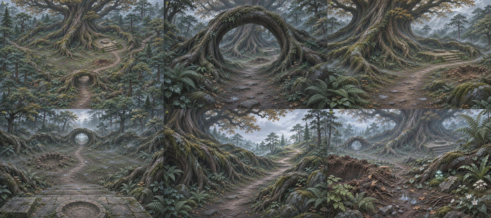
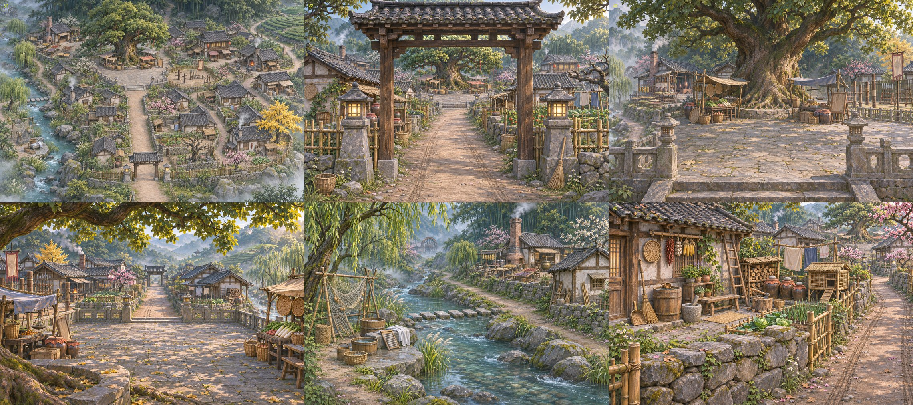

# 給協作者：承天現在的方向，和我們正在做的場景（2026-11-14）

> Claude Code 依 z1nnz 指示撰寫：「把我們現在的這個理念以及正在開發的場景告訴協作者，說我們正在做的看起來長怎樣」。請三位都先讀這份，再讀自己的工作包。

## 一、我們在做什麼

**承天**是一款東方仙俠的開放世界遊戲。玩家從山谷裡的小村子「青溪村」開始，前十天在河谷、古林、茶田、溪邊生活和探索，第十天爬上山門進入山城。

新手區的第一圈有 **13 塊**，每塊 100 × 100 公尺：

| 類型 | 區塊 |
|---|---|
| 村與河谷（A） | A1 青溪村、A2 村外官道與茶亭、A3 西溪水磨坊、A4 東坡茶田、A5 河灣渡口、A6 稻田與大水車 |
| 古林（D） | D1 林緣獵場、D2 古樹神木、D3 上游溪谷、D4 苔石古祠、D6 古林往山腳 |
| 山上（B） | B1 山門石階、B2 山城街與廣場 |

## 二、做法改了：一塊一塊做到完

以前是一件件做模型，再找地方擺，結果每塊地都很空（青溪村 100 × 100 m 只擺了 62 件）。從 11/14 起改成：

1. **每塊先出六張同一個地方的設定圖**：俯視全區、入口第一眼、地標近景、反向回看、往下一塊的出口、地面小物近景。
2. **看著圖逐件數出這一塊要哪些東西**，列成物件清單。一塊大約 **50–80 種、350–1,100 件**（同一個模型擺很多次）。
3. 照清單分工建模（你們、Codex、Claude Code）。
4. Codex 照圖把物件擺進場景、整合進遊戲，用同樣的鏡位拍圖和設定圖比對，改到像為止。
5. z1nnz 看過並排圖才算這一塊完成。

所以你們這次的工作包，**每一件都寫了它擺在哪一塊、在哪張設定圖看得到**。做的時候請對著那張圖做，比例、材質、顏色要和圖裡同一個世界。

## 三、我們正在做的兩塊

### D2 古樹神木（試做塊）

感覺：**自己很小，這裡很老。** 一棵高約 90 m 的神木，板根比人高兩三倍，放射出去圍成一片空地；南邊有一座巨根交纏成的拱門當入口；根間有一座石祭壇，旁邊一個新挖的坑。除了祭壇，沒有任何人造物。外圈是層狀的松林，林下濕泥路、踏石、蕨、蕈、苔、落葉。

物件清單約 54 種、900 件。進度：佈局完成，Codex 正在整合進遊戲；祭壇台石已完成（下圖），坑、踏石、地表盤根、朽木、斷枝堆、蕈菇、入口大根拱由 Codex 製作中。

### A1 青溪村

感覺：**有人住。** 不是一件件隔開展示，而是柴堆、晾衣、竹籃、醃菜甕擠滿每個院子。南邊村口門樓和石燈，中央石鋪廣場和比所有屋頂都高的古樟，西邊清溪、洗衣石台、曬網，西北煉丹角，東邊演武場和兩條彎巷的民居，東路上客棧、鐵匠鋪、材料鋪。

物件清單約 80 種、1,100 件，其中約 55 種已經有了（很多是你們做的：VL／VH 民居、石牆、竹籬、柴堆、石燈、洗衣小物、釣具、LV 生活小物）。

**注意**：設定圖裡的石燈是日式樣式，那是生圖的錯。遊戲裡用 Josh 的 LT01 中式石燈。所有東西都要是中國南方山村的樣子，不要日式（木屐、鳥居、日式石燈籠）。

## 四、品質標準

- **看齊**：Josh 的 VL 民居、石牆，Eli 的 LV 生活小物，是目前最好的範本。新的東西要和它們放在一起不輸。
- **樹**：照 `tree-method/` 的天空島世界樹做法（一片片立體小葉、沿枝梢流排列、三級細枝），禁止葉片卡。
- **顏色**：沉穩，照風格色票，不要螢光綠和亮黃。
- **面數**：品質優先，用 LOD 控制；每件交 LOD0–2。

## 五、分工總覽

| 誰 | 工作包 | 時數 |
|---|---|---:|
| Josh | `B-120h-village-and-old-places.md` ＋ 樹（`樹木重做-v2-分工.md`） | 120 ＋ 40 |
| John | `A-120h-roads-yard-and-mountain-street.md` ＋ 樹（`樹木重做-v2-分工.md`） | 120 ＋ 36 |
| Eli | `C-120h-yards-undergrowth-and-wayside.md`（已含林下灌木和幼樹） | 120 |
| Codex | D2 模型（坑、踏石、盤根、朽木、斷枝、蕈、入口大根拱）、整合進遊戲 | － |
| Claude Code | 所有設定圖和參考圖、地標樹（D2 神木、A1 古樟、古林巨木）、審查 | － |

需要參考圖（三視圖或場景圖）而自己生不出來的，在 PR 或信裡說，Claude Code 用 ChatGPT 出給你。
